<h3><code>thilak@github ~ $ ./contributions.sh</code></h3>

  
<h3><code>thilak@github ~ $ whoami</code></h3>
<table>
  <tr>
    <td valign="top"></td>
    <td valign="top"></td>
  </tr>
</table>
  
<h3><code>thilak@github ~ $ cat projects.txt</code></h3>
<table>
  <tr>
    <td><b>Calculator App</b> · Python Command-line calculator with error handling for invalid input and division by zero. <a href="https://github.com/thilak-codes/calculator">View repo →</a></td>
    <td><b>To-Do List App</b> · Python CLI task manager (add / remove / view) that saves tasks between sessions using file I/O. <a href="https://github.com/thilak-codes">View repo →</a></td>
  </tr>
</table>
 
<h3><code>thilak@github ~ $ ./contact.sh</code></h3>

  
CSE student · Python · SQL · C · open to software development internships

[README (2).md](https://github.com/user-attachments/files/33771553/README.2.md)
