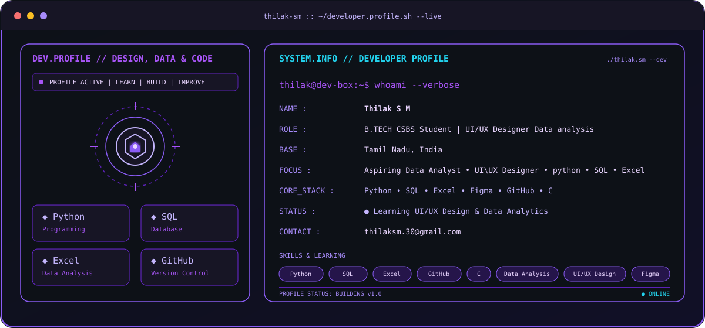
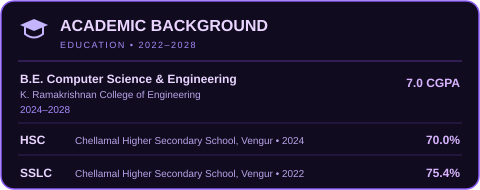

<!-- ===== THILAK S M | CYBER COMMAND GITHUB PROFILE ===== -->

  

<!-- ===== PURPLE THEME: STATS + TOP LANGUAGES ===== -->

  <picture>
    <source media="(prefers-color-scheme: dark)"
      srcset="https://github-readme-stats-sigma-rosy-28.vercel.app/api?username=thilak-codes&show_icons=true&count_private=true&include_all_commits=true&hide_rank=true&hide_border=false&title_color=C4B5FD&icon_color=A855F7&text_color=E9D5FF&bg_color=0D1117&border_color=8B5CF6&card_width=500" />
    
  </picture>

  <picture>
    <source media="(prefers-color-scheme: dark)"
      srcset="https://github-readme-stats-sigma-rosy-28.vercel.app/api/top-langs/?username=thilak-codes&layout=compact&langs_count=8&hide_border=false&title_color=C4B5FD&text_color=E9D5FF&bg_color=0D1117&border_color=8B5CF6&card_width=500" />
    
  </picture>

<!-- ===== MATRIX CONTRIBUTION SNAKE ===== -->

<picture>
  <source media="(prefers-color-scheme: dark)" srcset="https://raw.githubusercontent.com/thilak-codes/thilak-codes/output/snake-dark.svg" />
  <source media="(prefers-color-scheme: light)" srcset="https://raw.githubusercontent.com/thilak-codes/thilak-codes/output/snake-light.svg" />
  
</picture>

  
  
  

---

## `tech_stack` — Skills & Tools

  

  
  
  
  

<!-- EDUCATION - NEON AMETHYST THEME -->

  

## `career_goal` — What I'm Working Toward

My goal is to secure a **software developer** where I can apply my programming knowledge, contribute to real-world projects, learn industry practices, and grow as a developer in a collaborative environment.

I'm focused on improving my technical skills through hands-on practice and building projects that demonstrate what I learn.

---

## `featured_projects` — Projects

  

- 🐍 **Python Projects** — Practical programs and exercises to strengthen programming fundamentals.
- 📊 **Data Analysis Projects** — Exploring data cleaning, analysis, and spreadsheet-based insights.
- 🌐 **Web & DevOps Projects** — Learning web technologies and development workflows.
- 🔐 **Cybersecurity Practice** — Exploring security concepts through authorized learning environments.

> Add links and short descriptions here as you publish your projects.

---

---

## `connect` — Find Me Online

  
  
  

---

  <i>"Learn continuously. Build thoughtfully. Improve every day."</i>

  

  Thanks for visiting my profile.

<!-- ===== END OF README ===== -->

